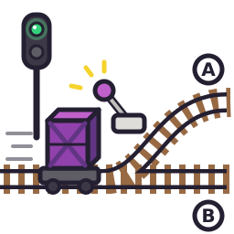

<p align="center">
  
</p>

<h1 align="center">switchyard</h1>

<p align="center">
  <a href="https://github.com/xuedi/switchyard/releases"></a>
  <a href="LICENSE"></a>
  <a href="https://go.dev"></a>
  
</p>

<p align="center"><b>The tiny canary and rollback tool for image-based apps on a small Kubernetes.</b><br>
Your app pushes a tagged image; switchyard moves a Deployment from tag to tag, and backs it up.<br>
One Go binary next to kubectl. No operator, no CRDs, no router.</p>

---

Argo Rollouts and Flagger are built for clusters with a service mesh and a team to run them.
On a small cluster with one or two apps that is more machinery than the apps themselves, and a
plain `kubectl set image` gives you no canary, no guard for the migrations and no history to
roll back to. switchyard is the middle ground: pick a Deployment, and every newer tag in its
registry gets a **Canary** and a **Deploy** button, every tag that went live a **Roll back**.

## Why switchyard

- **Two drop-downs to add an app.** Pick a namespace, pick its Deployment. switchyard reads the
  registry and the credentials from the Deployment itself; everything else is optional.
- **A canary without a router.** A copy of the Deployment runs the new tag with the same pod
  labels, so the app's own Service sends it a share of the traffic: one pod next to the old
  ones, then as many as the old ones. Small sites have few visitors, so during every step
  switchyard requests your pages from a new pod and an old one, round after round, and aborts
  at the first error.
- **Rollback to any kept tag.** The last five tags that went live are kept; Roll back puts one
  back at once, and its image is usually still on the nodes.
- **A guard against destructive migrations.** The old code keeps running on the migrated
  database, during a canary and after a rollback. Before anything moves, switchyard runs your
  pending-SQL command in the new image and stops on drops, renames and `NOT NULL` without a
  default, with a **Deploy anyway** for the planned last step. Then the migrate command, then
  the traffic.
- **Backups and restores.** A namespace's databases and volumes as plain dated archives on a
  PVC, on a schedule or by hand; a restore takes a safety backup first. See [Backups](#backups).
- **Least privilege.** The setup creates a service account whose Role covers only what the
  boxes need, namespace by namespace; the admin context is used only to add a box.
- **No load when nobody looks.** The page polls every second while it is open; all viewers share
  one snapshot, and with nobody watching switchyard does not call the cluster.

## How it works

Each **box** is one Deployment. Its live tag is whatever the Deployment runs; the history (the
tags that went live, the last runs and their logs) is a ConfigMap `switchyard-<deployment>` next
to it, so a reinstalled switchyard finds it again.

| Button | What happens |
|---|---|
| **Canary** | The pending-SQL check and the migrate command in Jobs of the new image. Then `<deployment>-canary` with 1 pod of the new tag next to the live ones, watched for the pause; then as many pods as the live ones (about half the traffic), watched again. Then the Deployment gets the tag (a normal rolling update), the followers too, the copy goes, and the cache command runs. A failure, or **Abort**, deletes the copy; nothing else changed. |
| **Deploy** | The same migrations, then the tag on the Deployment and the followers at once, then the cache command. |
| **Roll back** | A kept tag on the Deployment and the followers at once, then the cache command. The database is not rolled back. |

**Followers** are CronJobs and Deployments that run the same image (a scheduler, a worker):
they get the tag at every switch. If a rollout does not finish within 10 minutes, the
Deployment goes back to the tag it had.

## Install

switchyard runs as a user service on any always-on Linux machine with `kubectl` and an admin
kubeconfig for the cluster, inside or outside it.

```bash
curl -fsSLO https://github.com/xuedi/switchyard/releases/download/v0.10.0/switchyard-0.10.0-linux-amd64
install -m 0755 switchyard-0.10.0-linux-amd64 ~/.local/bin/switchyard   # or -arm64, -armv7
switchyard setup                                                        # 127.0.0.1:8083
```

`switchyard setup` prints the installer's URL with a one-time token; without it the installer
answers nothing, so nobody who reaches the port first can set switchyard up. The admin
kubeconfig is `$KUBECONFIG` or `~/.kube/config`, or the file given with `-kubeconfig`. The
installer checks `kubectl` and the kubeconfig, tests the admin context, asks for a user, a
password and the address to listen on, and then:

- creates the namespace `switchyard` with a service account and its token,
- writes `~/.config/switchyard/kubeconfig` with only that token, and `config.json` (both 0600),
- writes `~/.config/systemd/user/switchyard.service`.

Then stop the installer and start the service for good:

```bash
systemctl --user daemon-reload
systemctl --user enable --now switchyard
loginctl enable-linger $USER   # keep it running without a login
```

## Behind a reverse proxy

switchyard speaks plain HTTP: keep it on 127.0.0.1 behind a reverse proxy with HTTPS. Every
link is relative, so any path prefix works. A request from a trusted proxy (`trustedProxies` in
`config.json`, addresses or CIDR ranges, the loopback when empty) has its `X-Forwarded-Proto`
and `X-Forwarded-For` believed: the session cookie is `Secure` when the browser is on HTTPS,
and the client is the rightmost address that is not a trusted proxy. Nobody else's forwarding
headers count.

- **The login:** a signed session cookie that ends 12 hours after the last request, a week
  after the login at the latest. Ten failed logins from one client in 15 minutes lock it out
  for 15 minutes, and one password check runs at a time.
- **Password** (in the header) changes the password and logs out every other session; **Log out
  everywhere** there ends them all.
- Clicks are protected against cross-site requests; the pages run only their own scripts and
  are framed only by their own origin.
- Every action leaves one `audit` line in the journal (`journalctl --user -u switchyard`): the
  user, the client, the action, the box, the tag, the result. A run's log starts with who
  started it from where.

## Adding a box

**Add a box**, pick the namespace and the Deployment. That is all that is required; under
**More**:

| Field | Meaning |
|---|---|
| Container | which one, when the pod has several |
| Followers | CronJobs and Deployments in the namespace that run the same image |
| Pending-SQL command | prints the SQL of the pending migrations, nothing when none; run in the new image before anything moves |
| Migrate command | runs the migrations; in the new image, after the check, before any traffic |
| Cache command | runs after every switch, forward and back |
| Site | e.g. `https://shop.example.org`: its host goes as `Host`, its scheme as `X-Forwarded-Proto` with every probe, and it is linked |
| Pages | the paths requested from a new and an old pod during each canary step |
| Links | more links in the header, `label=url ...` |
| Seconds per canary step | 120 if empty |
| Tags kept for rollback | 5 if empty |

The commands run in a Job made from the Deployment's pod spec: the same environment, volumes
and security context, the new image, the probes and ports left out. A command is split at
spaces, no shell.

Adding, changing or removing a box writes switchyard's Role in that namespace, so it needs the
admin context once. If the namespace has no pull secret for the image's registry, the form
takes a token: it is stored as the Secret `switchyard-pull` and added to the pods' service
account.

## The image contract

What your app's build has to deliver for switchyard:

- **Immutable tags**, one per release: a tag is read once and never again. Moving tags such as
  `latest` are ignored.
- The label **`org.opencontainers.image.created`** (or the image's creation time): tags are
  ordered by it, since their names need not sort.
- Optional, shown on the page: `org.opencontainers.image.version` and `revision`,
  `switchyard.subject` (e.g. the commit subject), `switchyard.meta.<key>` (e.g. one commit per
  repository).
- If the app has migrations: a pending-SQL command (stdout the SQL, logs on stderr, a line
  `-- Version <name>` or `-- Migration <name>` before each migration's statements), a migrate
  command, and `sh` plus a writable `/tmp` in the image for the check's wrapper.
- Readiness probes that mean it: the canary waits for ready pods.

Registries: ghcr.io, Docker Hub and any registry with the OCI distribution API and bearer or
basic auth.

## Migrations

During a canary the old code runs on the migrated database, and a rollback goes back to such
code later. So a migration may only add: new tables, nullable columns or ones with a default,
indexes, foreign keys, backfills. switchyard blocks:

- `DROP TABLE`, `TRUNCATE`, `RENAME TABLE`, `DELETE FROM`
- `ALTER TABLE ... DROP` a column, `RENAME`, `CHANGE`, `MODIFY`, `ALTER COLUMN ... TYPE` or
  `SET NOT NULL`
- `ADD` a column `NOT NULL` without a default

`CHANGE` and `MODIFY` are blocked even when they only change a comment: without the live schema
a comment change cannot be told from a type change. Split a destructive change: add the new
thing, deploy, move the code over, deploy, then drop the old thing with **Deploy anyway** once
no kept tag needs it. The tags table marks a tag that dropped something, and Roll back warns
when it would cross one.

## Backups

switchyard also backs up and restores an app: a namespace's databases and volumes, as plain
dated archives on a PVC. **Back up a namespace** on the start page; the form suggests the
MariaDB and PostgreSQL StatefulSets (with their user, database and Secret keys read from the
official images' variables) and the other PVCs.

```
<target>/2026-10-17_05-10_database.sql.zst   mariadb-dump --single-transaction | zstd
<target>/2026-10-17_05-10_uploads.tar.zst    tar of the volume, its content at the root
<target>/2026-10-17_05-10_manifest.json      written last: sizes, sha256, the images live
```

Plain files: `zstd -d < x.sql.zst | head` and `tar -t --zstd -f x.tar.zst` open them. One
timestamp per run, in the set's time zone; a run without a manifest is incomplete.

- **Where they go:** a PVC in the namespace that the cluster admin binds to a directory (a
  static PV); switchyard only names it. Off-site copies are the host's job.
- **How:** a Job per run, its steps in order: a before-hook, the dumps in each database's own
  image (its dump tool matches the server), a `tar` per volume, an after-hook, then the manifest,
  the retention and a listing of the target, which switchyard reads from the Job's log. A failed
  step does not skip the after-hook; the run then fails without a manifest.
- **Schedule:** a CronJob `switchyard-backup` made from the set, so backups run without
  switchyard; always hot (`--single-transaction`, `pg_dump`). **Cold** scales the namespace's
  workloads (not its databases) to 0 for the backups started on the page. A host backup can
  skip namespaces by that name, so it stays as it is.
- **A schedule that stops** shows in red on the start page and the backups page: the CronJob
  suspended (with a button to resume it), the last scheduled run failed, or a slot passed more
  than an hour ago without a run. The newest archive shows its age.
- **Hooks:** a command run in a container made from a workload's pod spec, e.g. a maintenance
  mode on and off; its image needs `sh`.
- **Retention:** every run of the 5 newest dates, then the earliest complete run of each month
  for 12 months; a run goes as a whole. switchyard writes `.switchyard` into its target: a
  pruner of the host's should skip such a directory.
- **Restore** a run, all of it or single items: tick the warning that says what will happen (a
  set marked **production** wants the namespace typed in instead). First a
  safety backup of the set (marked pre-restore; it can be skipped when the data is too broken
  for one), then the namespace's workloads go to 0 and its CronJobs are suspended, each database
  is dropped, created and imported as the restore user (root), each volume emptied (top-level
  excludes keep their content) and extracted, then the after-hook and everything back up.
- **Import:** archives of another layout (from before switchyard) are restored file by file:
  per item, which archive of the run and, for a tar, which directory in it (`app/data/images`).
- **The tools image** runs the volume and listing steps: `sh`, `tar`, `zstd`, `sha256sum`; by
  default the first MariaDB's image, which has them.
- A backup or restore waits for a canary or deploy in the namespace, and the other way round.
- **Assumed:** one node (the Job mounts the target and the volumes at once), and NetworkPolicies
  that let a Job's pod reach the databases (its pods carry
  `app.kubernetes.io/managed-by: switchyard`). The Jobs mount the namespace's PVCs and its
  Secrets by reference: with backups, switchyard's Role is close to namespace admin.

## Development

```bash
just check     # gofmt, vet, the builds for amd64, arm64 and armv7
just setup     # the installer on 127.0.0.1:8083, it prints its URL
just run       # the boxes on 127.0.0.1:8083
just release   # the release binaries in dist/
```

Standard library only. `XDG_CONFIG_HOME=/tmp/sy just setup` keeps a test setup apart from
your own.

## License

[EUPL v1.2](LICENSE)
