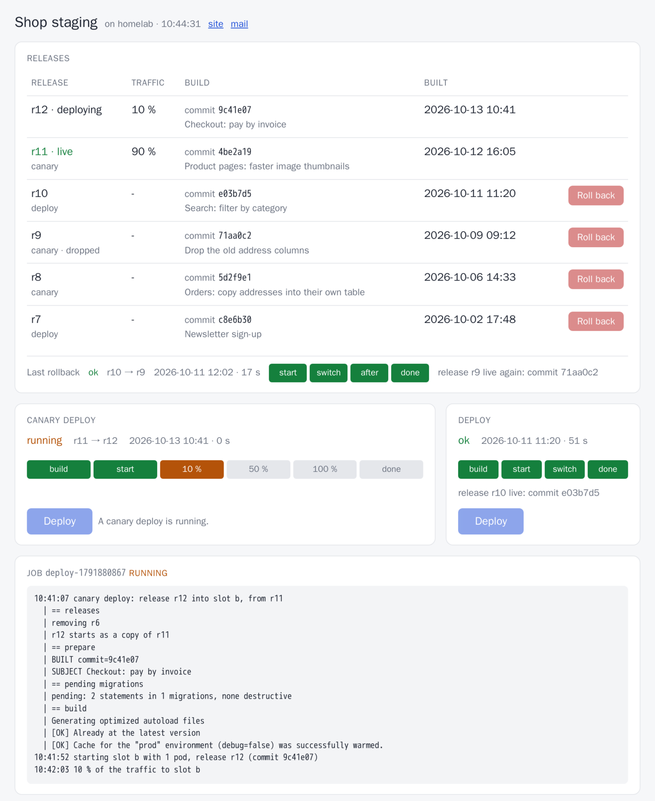

<p align="center">
  
</p>

<h1 align="center">switchyard</h1>

<p align="center">
  <a href="https://github.com/xuedi/switchyard/actions/workflows/ci.yml"></a>
  <a href="https://github.com/xuedi/switchyard/releases"></a>
  <a href="LICENSE"></a>
  <a href="https://go.dev"></a>
  
  
</p>

<p align="center"><b>Canary deploys and rollbacks for apps built in place, on a small Kubernetes.</b><br>
For PHP, Node or Python apps whose releases are directories on a volume:<br>
no image per release, no registry, no CI. One Go binary, one page.</p>

---

I run a staging copy of a PHP app on a small k0s cluster at home. Building an image for every
commit, pushing it to a registry and rolling it out was more machinery than the app itself, and
plain `git pull` on a volume gave me no way back. switchyard is the middle ground: every deploy
builds the code into a new directory on a volume, two slots take turns running a release, the
traffic moves over in steps while switchyard sends its own requests to both, and the last five
releases stay on disk for a rollback in seconds.

<p align="center"></p>

## Why switchyard

- **No image per release.** The code is built where it runs: a build Job fetches it into a new
  release directory, which starts as a copy of the live one, so dependencies and assets only
  change where the code did. A quick deploy of a Symfony app takes under a minute.
- **A canary with its own traffic.** Small sites have few visitors, and 10 % of few tests
  nothing. During every step switchyard requests your list of pages from the new release and
  the old one, round after round, and aborts at the first error or slow answer.
- **Rollback to any kept release.** The last five releases stay on the volume. Roll back moves
  all traffic at once and needs no build: about 15 seconds.
- **A guard against destructive migrations.** The old release keeps running on the migrated
  database, during a canary and after a rollback. switchyard reads the pending SQL first and
  stops on drops, renames and `NOT NULL` without a default, with a **Deploy anyway** for the
  planned last step.
- **Least privilege, enforced by the cluster.** The page's token can create Jobs only as
  unchanged copies of three CronJobs; an admission policy checks it. The build Job gets no
  token at all.
- **One binary, both halves.** The page, and `switchyard manifests`, which renders the cluster
  side from one config file: no helm, no kustomize, no operator, no CRDs.
- **No load when nobody looks.** The page polls every second while it is open; all viewers share
  one snapshot, and with nobody watching switchyard does not call the API.

## How it works

Two Deployments, slot **a** and slot **b**, mount the releases volume with subPath. One is
live; the other is idle, or runs the new release while the traffic moves. A router splits the
traffic between their Services by weight (Caddy so far).

| Button | What happens |
|---|---|
| **Deploy** (canary) | build a new release `r<n>`, start it in the idle slot with one pod, move 10 % then 50 % of the traffic there with a health watch after each step, then 100 %; the old slot stops. Any failure before the end sends all traffic back. |
| **Deploy** (quick) | the same build, all pods, 100 % at once, no watch. A bad release is undone with a rollback. |
| **Roll back** | a kept release into the idle slot, 100 % at once, then your `after-rollback` hook (e.g. clear a cache). The page warns before going back more than one release. |
| **Deploy anyway** | after the build stopped on a destructive migration: the same deploy, migrating anyway. |

Each click (and a second one to confirm) creates a Job from a suspended CronJob, as
`kubectl create job --from=cronjob/deploy` does; the Job runs `switchyard.sh`, which keeps the
state in a ConfigMap the page reads. Workloads that run the same code, like a scheduler, follow
the live release. More in [docs/](docs/README.md).

## Install

**1. Write the app's config and hooks.** A config file with the keys below, and a `hooks/`
directory next to it with at least a `build` hook. Start from
[`examples/symfony-doctrine/`](examples/symfony-doctrine/): `app.env`, the hooks, and
`slots.yaml` with the two slots and a follower. Mark your app's block in the Caddyfile:

```
shop.example.org {
	reverse_proxy {
		# BEGIN shop
		to shop-a.shop.svc.cluster.local:8080
		# END shop
	}
}
```

**2. Render and apply the cluster side**, then the slots:

```bash
switchyard manifests --config app.env | kubectl apply -f -
kubectl apply -f slots.yaml
```

The binary: `go install github.com/xuedi/switchyard@latest` (Go 1.25+), or the image:
`docker run --rm -v "$PWD:/c" ghcr.io/xuedi/switchyard manifests --config /c/app.env`.

**3. Deploy once by hand** to see the build work, before any page is involved:

```bash
kubectl -n shop create job --from=cronjob/quick quick-$(date +%s)
kubectl -n shop logs -f job/<that name>
```

**4. Run the page** on a machine that reaches the API server, with the dashboard's token:

```bash
mkdir -p data
kubectl -n shop get secret shop-dashboard-token -o jsonpath='{.data.token}'  | base64 -d > data/token
kubectl -n shop get secret shop-dashboard-token -o jsonpath='{.data.ca\.crt}' | base64 -d > data/ca.crt
docker run -d --name switchyard --restart unless-stopped -p 8080:8080 \
  -e SWITCHYARD_API=https://192.168.1.10:6443 -e SWITCHYARD_NAMESPACE=shop \
  -e SWITCHYARD_STATE=shop-release -e SWITCHYARD_TITLE="Shop staging" \
  -v "$PWD/data:/data:ro" --read-only --cap-drop ALL --security-opt no-new-privileges \
  ghcr.io/xuedi/switchyard:latest
```

or with [`deploy/docker-compose.yml`](deploy/docker-compose.yml). Images are built for amd64,
arm64 and armv7. Open `http://<that machine>:8080/`. `docker exec switchyard /switchyard check`
asks the API server whether it would accept all three Jobs, without starting one.

## Configuration

### The page

| Variable | Default | |
|---|---|---|
| `SWITCHYARD_API` | | The API server, e.g. `https://192.168.1.10:6443` |
| `SWITCHYARD_NAMESPACE` | | The app's namespace |
| `SWITCHYARD_TOKEN` | `/data/token` | The dashboard's token file |
| `SWITCHYARD_CA` | `/data/ca.crt` | The cluster's CA certificate (PEM) |
| `SWITCHYARD_LISTEN` | `:8080` | Listen address |
| `SWITCHYARD_STATE` | `switchyard-release` | The state ConfigMap (`STATE` below) |
| `SWITCHYARD_JOB_PREFIX` | | `JOB_PREFIX` below |
| `SWITCHYARD_JOB_LABEL` | `app.kubernetes.io/name=switchyard` | `JOB_LABEL` below |
| `SWITCHYARD_TITLE` | the namespace | The heading and tab title |
| `SWITCHYARD_CLUSTER` | `The cluster` | Its name on the offline page |
| `SWITCHYARD_LINKS` | | Links in the header: `site=https://shop.example.org mail=https://...` |
| `TZ` | UTC | Time zone of the clock |

### The app (`app.env`)

`KEY=value` lines, taken literally (no shell expansion). `manifests` refuses unknown keys.

| Key | Default | |
|---|---|---|
| `APP`, `NAMESPACE` | | Required. `APP` names the objects (`<APP>-switchyard`, `<APP>-dashboard`) |
| `IMAGE` | | Required. Runs the deploy Jobs: needs bash, kubectl, curl, awk |
| `IMAGE_PULL_POLICY` | `IfNotPresent` | |
| `STATE` | `<APP>-release` | The state ConfigMap |
| `JOB_PREFIX` | | In front of the CronJob names, for several apps in one namespace, e.g. `shop-` |
| `JOB_LABEL` | `app.kubernetes.io/name=switchyard` | On the deploy, quick and rollback Jobs (for NetworkPolicies) |
| `RUN_AS` | `1000:1000` | uid:gid of the Jobs |
| `TZ` | | For the Jobs' log times |
| `SLOT_A`, `SLOT_B` | `<APP>-a`, `<APP>-b` | The slot Deployments; their Services have the same names |
| `PORT` | `8080` | The Services' port |
| `CODE_VOLUME` | `code` | The volume in the slots and followers that mounts the release |
| `RELEASES_PVC`, `RELEASES_SIZE` | `<APP>-releases`, `10Gi` | The releases volume |
| `RELEASES_ACCESS`, `STORAGE_CLASS` | `ReadWriteOnce`, cluster default | |
| `REPLICAS` | `2` | Pods of the live slot |
| `STEPS`, `PAUSE`, `DRAIN` | `10 50`, `120`, `30` | Canary steps in percent, seconds watched per step, seconds the old slot keeps running |
| `KEEP` | `5` | Releases kept |
| `HOST`, `FORWARDED_PROTO` | | `Host` and `X-Forwarded-Proto` of the watch's requests |
| `HEALTH`, `PAGES` | `/`, `/` | The health path; the pages requested during each step |
| `FOLLOWERS` | | `cronjob/<name>` or `deployment/<name>` running the live release |
| `RELEASE_ENV`, `RELEASE_VALUE` | , `{id}` | An environment variable set on slots and followers, e.g. for an error tracker; `{id}` and `{<meta key>}` filled in |
| `ROUTER` | `caddy` | |
| `CADDY_ADMIN`, `CADDY_CONFIGMAP` | | Caddy's admin API; `namespace/name` of the ConfigMap with the Caddyfile |
| `CADDY_KEY`, `CADDY_BLOCK`, `CADDY_COOKIE` | `Caddyfile`, `<APP>`, | Its key, the block's marker name, a sticky-slot cookie |
| `BUILD_IMAGE` | `IMAGE` | Runs the hooks: the app's image, with what the build needs |
| `BUILD_MOUNT` | `/app` | Where the release is mounted in the build Job |
| `BUILD_ENV_FROM` | | `configmap/<name>` and `secret/<name>` |
| `BUILD_ENV_<NAME>` | | One environment variable each |
| `BUILD_MOUNTS` | | `configmap/<name>:/path` and `secret/<name>:/path`, read-only |
| `BUILD_CPU`, `BUILD_MEMORY` | `200m`, `2Gi` | Request and limit of the build |
| `HOOKS` | `hooks` | The hooks' directory, relative to the config |

### Hooks

Plain bash, run in the release's directory by the build Job:

| Hook | |
|---|---|
| `prepare` | optional, first: fetch the code |
| `pending-sql` | optional: print the SQL of the pending migrations (the guard reads it) |
| `build` | required: dependencies, assets, migrations |
| `after-rollback` | optional: after a rollback, on the release now live |

A line `BUILT commit=1a2b3c4` (any `key=value`) is shown with the release, `SUBJECT <text>` under
it. Details: [docs/kit.md](docs/kit.md).

## Migrations

During a deploy the old release runs on the new schema, and a rollback goes back to old code
on it. So migrations follow **expand and contract**: add now, switch the code, drop only once
no kept release needs it. With a `pending-sql` hook the build enforces it, see
[docs/migrations.md](docs/migrations.md). switchyard never rolls the database back.

## Security

- **There is no login.** Anyone who can reach the page can deploy and roll back. Run it on a
  trusted LAN or behind a proxy that authenticates. All its links are relative, so any path
  prefix works.
- What the page's token can do is limited by the cluster, not by the page: read the state, the
  three CronJobs, Jobs and their logs, and create Jobs that a `ValidatingAdmissionPolicy` checks
  to be unchanged copies of the three CronJobs. No exec, Secrets, delete or scale.
- The one free part of such a Job is its name, so a rollback's target and Deploy anyway travel
  there (`rollback-r7-<time>`, `deploy-drops-<time>`); `switchyard.sh` validates the name, and a
  stolen token can only deploy what your hooks fetch, or roll back to a kept release.
- POSTs from other sites are refused (`http.CrossOriginProtection`).
- The build Job runs your app's code with your app's secrets, and no API token.
- The router's admin API changes the whole router: let only the deploy Jobs reach it, see
  [docs/routers.md](docs/routers.md).

## Development

```bash
just check                                   # gofmt, vet, tests, shellcheck
just run https://192.168.1.10:6443 data/token data/ca.crt shop
just manifests examples/symfony-doctrine/app.env
```

The tests run the page's read path and every button against a fake API server, render the
manifests, and run the shell parts (Job-name options, the Caddyfile rewrite, the SQL checker
against sample migrations); no cluster needed.

## License

[EUPL v1.2](LICENSE)
