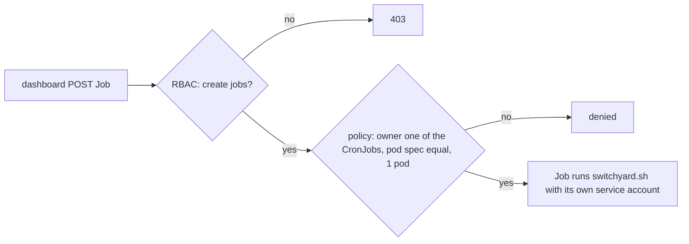

# Cluster access

Two service accounts, both rendered by `switchyard manifests`, both limited to the app's
namespace (plus one ConfigMap in the router's).

## The dashboard: `<APP>-dashboard`

Its token and the cluster's CA come from the Secret `<APP>-dashboard-token` and are mounted
read-only into the dashboard's container.

| Resource | Verbs | Limited to |
|---|---|---|
| configmaps | get | the state ConfigMap |
| cronjobs | get | `deploy`, `quick`, `rollback` (behind the prefix) |
| jobs | list, create | |
| pods | list | |
| pods/log | get | |

No exec, Secrets, delete, scale, or other namespaces.

### Admission policy

RBAC cannot limit what a created Job contains, so a `ValidatingAdmissionPolicy`
(`switchyard-<namespace>-<app>`, only for this account) does:

- exactly one CronJob ownerReference, naming one of the three CronJobs
- the Job's pod spec equal to that CronJob's pod spec (the policy reads the CronJob as its param,
  one binding per CronJob, so a new image needs no change to the policy)
- parallelism 1, completions 1 (filled in by the API server's defaults from the template)

So the token cannot run arbitrary pods or read Secrets through one. The Job's **name** is the
only free part, which is why a rollback's target and Deploy anyway travel in it, and why
`switchyard.sh` validates the name before acting on it. Even a stolen token can therefore only
start the three Jobs, with those options: deploy what the hooks fetch, or roll back to a kept
release.

## The Jobs: `<APP>-switchyard`

What actually changes the cluster is `switchyard.sh`, under its own account:

| Resource | Verbs | Limited to |
|---|---|---|
| deployments | get, list, watch, patch | the two slots and the follower Deployments |
| deployments/scale | get, patch, update | the two slots |
| replicasets | get, list, watch | (`kubectl rollout status`) |
| jobs | get, list, watch, create | (the build Jobs) |
| cronjobs | get, patch | the follower CronJobs |
| pods, pods/log | get, list, watch | |
| configmaps | get, patch | the state ConfigMap |
| configmaps in the router's namespace | get, patch | the router's config |

The build Job itself gets no token at all (`automountServiceAccountToken: false`): the hooks run
the app's own code, and need the database, not the API.
