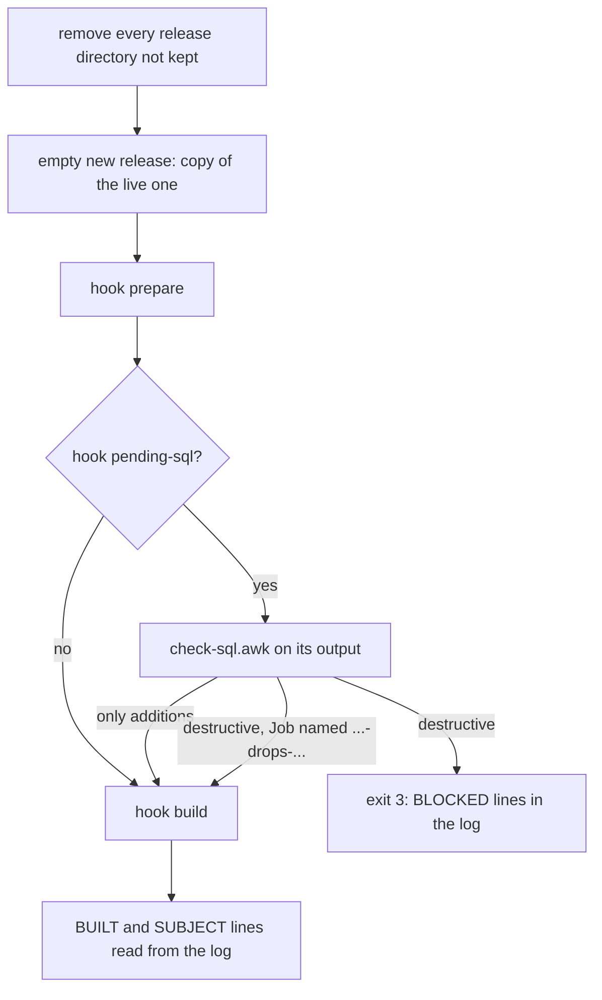

# The kit

Everything switchyard needs in the cluster is rendered from one config file per app and the
app's hooks:

```
switchyard manifests --config app.env | kubectl apply -f -
```

No kustomize or helm. The output is plain YAML; render it again after changing the config, a
hook or switchyard itself, and apply it again. Applying keeps the state ConfigMap's data and
the releases on the volume.

| Object | Name | What for |
|---|---|---|
| PersistentVolumeClaim | `RELEASES_PVC` | the releases, one directory each |
| ConfigMap | `STATE` | the state, written by `switchyard.sh` |
| ConfigMap | `<APP>-switchyard` | `switchyard.sh`, its config, the build Job, the router adapter, the hooks; mounted at `/switchyard` |
| CronJobs | `deploy`, `quick`, `rollback` (behind `JOB_PREFIX`) | suspended templates of the Jobs a click starts |
| ServiceAccount, Role | `<APP>-switchyard` | what `switchyard.sh` may do (see [cluster-access.md](cluster-access.md)) |
| Role in the router's namespace | `switchyard-<NAMESPACE>-<APP>` | the router's config, nothing else there |
| ServiceAccount, token Secret, Role | `<APP>-dashboard` | the dashboard's token |
| ValidatingAdmissionPolicy and 3 bindings | `switchyard-<NAMESPACE>-<APP>` | a Job from the dashboard is an unchanged CronJob copy |

`manifests` refuses a config with an unknown key, a missing required one, or values that cannot
work (names, numbers, rising steps, followers, mounts), before anything reaches the cluster.

## switchyard.sh

One bash script with the modes `deploy`, `quick`, `rollback` and `reapply` (in the Jobs of the
three CronJobs) and `build` and `after-rollback` (in the build Job). It needs bash, kubectl,
curl, sed and awk; busybox's are enough. `IMAGE` runs it: any image with those, the app's own
image or a small kubectl image.

The Job's name is the one free channel (see [starting-jobs.md](starting-jobs.md)), so the script
reads it from its pod's `job-name` label:

| Job name | Means |
|---|---|
| `rollback-r<n>-<time>` | roll back to `r<n>` |
| `deploy-drops-<time>`, `quick-drops-<time>` | let destructive migrations through |
| `deploy-reapply-<time>` | the deploy Job runs `reapply`: slots, followers and weights written again |

Only one deploy, quick or rollback Job runs at a time; a second one stops at once.

## The build Job

`switchyard.sh` starts it from `job.yaml` for each new release: the release's directory is
mounted at `BUILD_MOUNT` with subPath, the whole volume at `/releases`, the kit at
`/switchyard`. It runs as `RUN_AS` in `BUILD_IMAGE` (the app's image, with whatever the hooks
need), with `BUILD_ENV_FROM`, `BUILD_ENV_<NAME>` and `BUILD_MOUNTS` from the config.



Starting from a copy of the live release means a build only adds what changed: dependencies,
compiled assets and caches are already there.

## Hooks

Plain bash files in the directory `HOOKS` next to the config, run in the release's directory.

| Hook | When | Contract |
|---|---|---|
| `prepare` | optional, first | fetch the code and whatever the check below needs; nothing that touches shared state |
| `pending-sql` | optional | print the SQL the pending migrations would run, nothing when none; logs to stderr |
| `build` | required | the rest: dependencies, assets, migrations, warm-up |
| `after-rollback` | optional | after a rollback, on the release now live (e.g. clear a shared cache) |

Any hook can print `BUILT key=value ...` (shown per release, `r<n>_meta_<key>`, values without
spaces) and `SUBJECT <text>` (one line under it). A hook that fails fails the build, and a
failed build changes nothing: the live release keeps all traffic.

## Config

The keys and their defaults are in the README. Values are taken literally, no shell expansion,
so `$(VAR)` in `BUILD_ENV_*` reaches Kubernetes as written and is expanded there.
