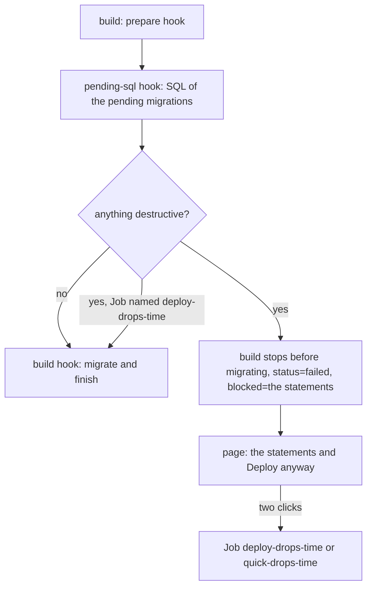

# Migrations

A build runs the pending migrations before any traffic moves, while the old release keeps
serving on that database, and a rollback later goes back to old code on the new schema. So a
migration may only **add**: tables, nullable columns or ones with a default, indexes, foreign
keys, backfills. A drop or rename breaks the release that is still live.

The rule for the app's migrations is **expand and contract**: add what the new code needs now,
switch the code over, and drop what the old code used only `KEEP` releases later, once no kept
release needs it.

## The guard

When the app has a `pending-sql` hook, the build stops before migrating if a pending statement
is destructive. `check-sql.awk` (POSIX awk, no database needed) reads the SQL and names:

| Statement | Why it breaks the old release |
|---|---|
| `DROP TABLE`, `DROP VIEW` | it reads them |
| `TRUNCATE`, `DELETE FROM` | its rows are gone |
| `RENAME TABLE`, `ALTER TABLE ... RENAME` | it uses the old name |
| `DROP [COLUMN] x`, `RENAME COLUMN`, `CHANGE x y` | it reads the column |
| `MODIFY`, `CHANGE x x`, `ALTER COLUMN x TYPE / SET NOT NULL` | its values may no longer fit |
| `ADD x ... NOT NULL` without a default | its inserts fail |

Dropping an index, key or constraint passes. MySQL, MariaDB and PostgreSQL syntax are covered.
A line `-- Version <name>` (Doctrine's `--write-sql`) or `-- Migration <name>` names the
migration of the statements below it.

**Deploy anyway** is for the planned last step of a change: dropping what no kept release uses
any more. The release is marked `r<n>_drops`, and the page warns before a rollback past it.

## The database is not rolled back

Migrations stay. The page warns before a rollback further back than one release, and names any
release in between that dropped something on purpose.
