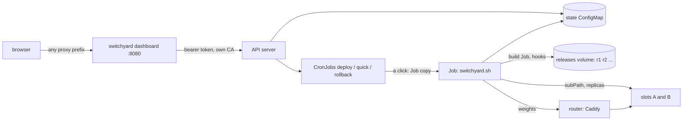

# Overview

switchyard has two halves, both in one Go binary (standard library only):

- **The dashboard**: one page, embedded in the binary, that shows the releases and starts a
  deploy, quick deploy or rollback. It runs wherever it can reach the API server, best outside
  the cluster, so it can still answer while the cluster is switched off and say "offline".
- **The kit**: the cluster side. `switchyard manifests --config app.env` renders it from one
  config file per app: three suspended CronJobs whose Jobs run `switchyard.sh`, a build Job
  template, the releases volume, the state ConfigMap, RBAC for both halves and an admission
  policy. The app's own slots (two Deployments and their Services) stay the app's.

## Pieces

- `main.go` the dashboard's config from `SWITCHYARD_*`, routes, the `starter`, subcommands
  `healthcheck` (container HEALTHCHECK, the scratch image has no curl), `check` (dry run of all
  three Jobs), `manifests` and `version`.
- `kube.go` minimal API client: one server, one token, one namespace. `view()` reads,
  `newJob()` is the only write.
- `snapshot.go` the cached view shared by all viewers, refreshed only while polled.
- `manifests.go` reads an app's config, checks it and renders the kit.
- `kit/` `switchyard.sh`, `check-sql.awk`, the router adapters and the manifest templates,
  embedded in the binary.
- `web/page.html` plain HTML and JS, polls `state` every second, POSTs `deploy`, `quick` or
  `rollback`.

## Routes

| Route | Does |
|---|---|
| `GET /` | the embedded page |
| `GET /state` | the snapshot as JSON (`View`), `no-store` |
| `POST /deploy`, `POST /quick`, `POST /rollback?release=r<n>` | start a Job, 204 / 409 refused / 502 API error; `?allow=drops` on deploy and quick: Deploy anyway |
| `GET /healthz` | `ok <version>` |

All wrapped in `http.NewCrossOriginProtection`: a click is a real deploy, no other site may
trigger one. All links in the page are relative, so it works under any proxy prefix.

## Container

`FROM scratch`, uid 65532, read-only, all caps dropped, no-new-privileges. Bundles
`time/tzdata` so `TZ` works without zoneinfo. Token and CA mounted read-only in `/data`.
Multi-arch by cross-compiling in the build stage, no emulation.
