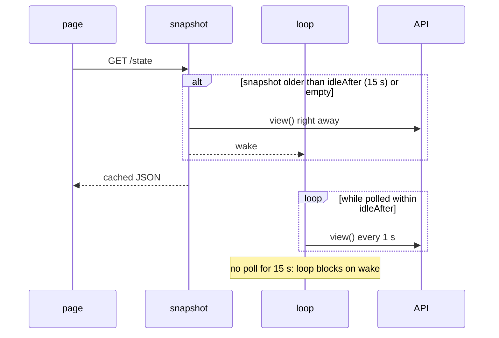

# Polling and the snapshot

The page polls `state` every second. All viewers share one `snapshot`, so ten tabs cost what one
does, and with nobody watching the API is not called at all.

After a successful POST the handler calls `refresh()` so the next poll already shows the new Job.

## One view()

1. GET the state ConfigMap. **No answer** (network, timeout 3 s) means `Online=false` and
   nothing else is read: the cluster is off. An **error answer** (`apiError`, e.g. a missing permission) still
   counts as online and goes into `Error`.
2. List Jobs with the label `SWITCHYARD_JOB_LABEL` (deploy, quick and rollback carry it, build
   Jobs do not), newest first. Any of them still running sets `Busy`.
3. For the newest Job: its newest pod (`job-name=`) and the last 40 log lines.

A Job is `running` until it has a `Complete` or `Failed` condition with status True. Its kind is
the owning CronJob's name without `SWITCHYARD_JOB_PREFIX`, falling back to the Job's name.

The page keeps the last view when switchyard itself is briefly unreachable.
