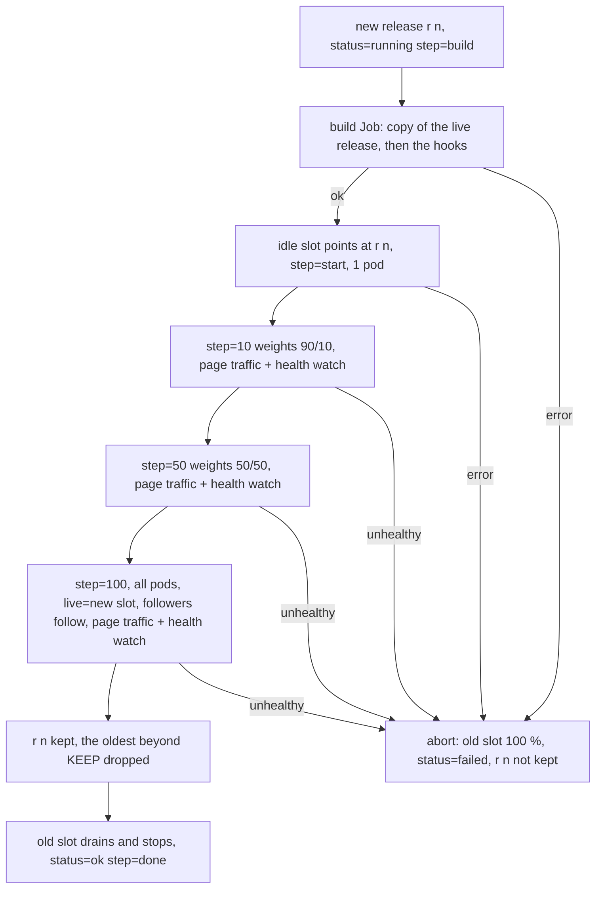
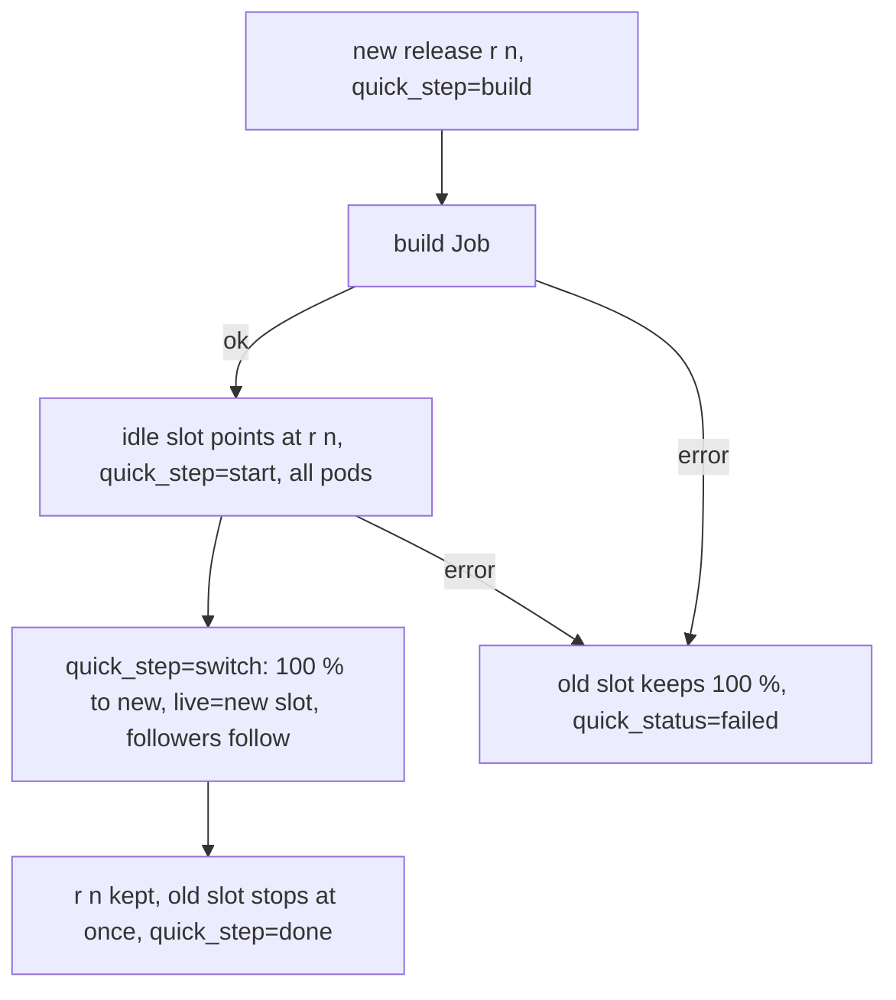
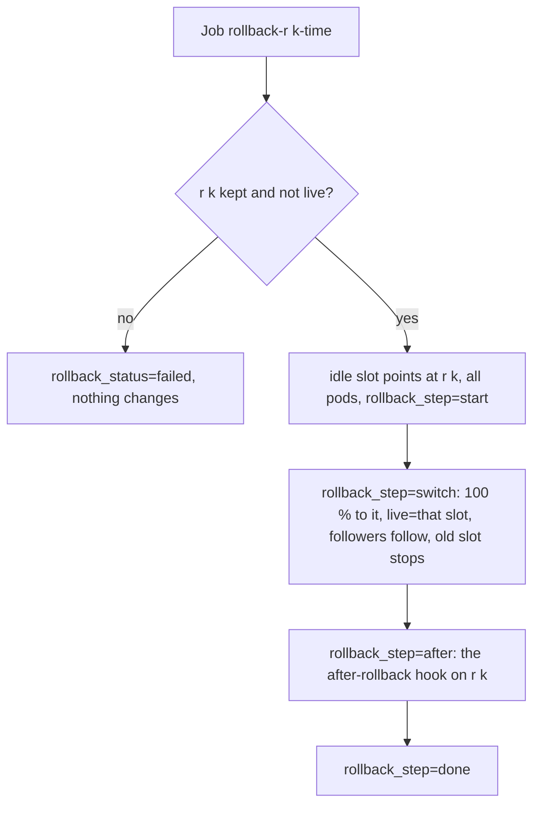

# Releases and their state

An app under switchyard keeps its code as **releases**: every deploy builds into a new
directory `r<n>` on one volume (the releases volume). The last `KEEP` releases that went live
are kept, the live one always; the next build removes every other directory. Two Deployments,
slot **a** and slot **b**, are where releases run: each mounts one release with subPath. The
live slot has `REPLICAS` pods; the other one is at 0, or runs the new release while a canary
moves traffic to it. The router splits the traffic between the slots by weight.

`switchyard.sh`, running inside the deploy, quick or rollback Job, keeps all of this in the
state ConfigMap. The dashboard only reads it. A new key there is a new field in the dashboard
(`Release` / `Run` in `kube.go` and the page).

## Keys

| Key | Meaning |
|---|---|
| `releases` | the kept releases, newest first, e.g. `r9 r8 r7 r6 r5` |
| `next`, `keep` | the number of the next release, how many are kept |
| `r<n>_meta_<key>` | what the build reported on its `BUILT key=value ...` lines, e.g. the commit |
| `r<n>_subject`, `r<n>_built` | the build's `SUBJECT` line, build time |
| `r<n>_by` | `canary` or `quick` |
| `r<n>_drops` | `1` when it ran destructive migrations on purpose |
| `live` | the slot with the traffic, `a` or `b` |
| `a_release`, `b_release` | the release each slot runs |
| `weight_a`, `weight_b` | traffic percent |
| `status`, `step`, `message`, `started`, `finished`, `from`, `to` | the last canary deploy; `step` is `build`, `start`, the `STEPS` percentages, `100`, `done` |
| `blocked` | the destructive statements that stopped the last canary's build, one per line |
| the same with `quick_` | the last quick deploy; `step` is `build`, `start`, `switch`, `done` |
| the same with `rollback_` | the last rollback; `step` is `start`, `switch`, `after`, `done` |

The dashboard also reads `r<n>_core` and `r<n>_multisite`, the form an early version wrote.

## Canary deploy

The health watch brings its own traffic: a small site has hardly any visitors, so 10 % of them
would test nothing. During every step `switchyard.sh` requests the app's `PAGES` from the new
slot directly, through its Service, round after round for the whole `PAUSE`, with the `HOST`
header the router would send. Any answer of 400 or more, a timeout, or too few ready pods
aborts.

Every round also goes to the **old** release, which runs on the migrated database the whole
time. If the old one breaks (right after the build, or during a step) while the new one is
fine, the canary does not go back, since the database is already migrated: it moves all traffic
to the new release at once and says so in its message.

## Quick deploy

No pauses and no health watch after the switch: a bad release is undone with a rollback.

## Rollback

The release to go back to travels in the Job's name, because the Job itself has to be an
unchanged copy of the CronJob (see [cluster-access.md](cluster-access.md)). A rollback does not
change the list of kept releases, it only moves `live`. The database is not rolled back, see
[migrations.md](migrations.md).

## Followers

Other workloads that run the app's code, a scheduler CronJob or a queue worker, are listed in
`FOLLOWERS`. Whenever the traffic moves to a slot for good, they are pointed at that slot's
release too, with the same subPath patch. `RELEASE_ENV` (for example the release name an error
tracker reports) is set on slots and followers alike.
