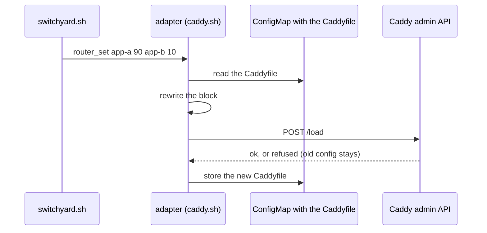

# Routers

The slots are two Services. Something in front of them has to split the app's traffic between
them by weight: the router. `switchyard.sh` talks to it through an adapter, a bash file in
`kit/router/` that is sourced by the script and defines one function:

```
router_set <service> <weight> [<service> <weight>]
```

All of the app's traffic to these Services, by weight, 100 in all; a Service with weight 0 gets
none. The adapter returns non-zero when the router refused the change, and then the traffic
must still flow as before. Services are in the app's namespace, on `PORT`. `ROUTER` in the
config picks the adapter; its keys are its own (`CADDY_*`), and `manifests` renders a Role for
what it needs to touch.



## Caddy

Caddy reads its Caddyfile from a ConfigMap (`CADDY_CONFIGMAP`, key `CADDY_KEY`). In the app's
`reverse_proxy`, mark a block for switchyard:

```
shop.example.org {
	reverse_proxy {
		# BEGIN shop
		to shop-a.shop.svc.cluster.local:8080
		# END shop
		header_up X-Forwarded-Proto https
	}
}
```

The adapter rewrites only the lines between the markers, keeping their indentation: the
upstreams with weight above 0, and `lb_policy weighted_round_robin <weights>`, or with
`CADDY_COOKIE` set, `lb_policy cookie <name>` with the weights as its fallback, so a visitor
stays on one slot. The new Caddyfile is loaded through the admin API (`CADDY_ADMIN`); Caddy
refuses a bad one and keeps the old. Then it is stored back, so a restarted Caddy starts with
the current weights.

The admin API changes Caddy's whole config, so let only the deploy Jobs reach it: a
NetworkPolicy on the admin port that admits pods with the Jobs' label (`JOB_LABEL`) from the
app's namespace.

## Other routers

Not written yet. Gateway API: patch the `weight` of the two `backendRefs` of an HTTPRoute.
nginx-ingress: a second Ingress with `nginx.ingress.kubernetes.io/canary: "true"` and
`canary-weight`. Either is one adapter file and a Role for the object it patches.
