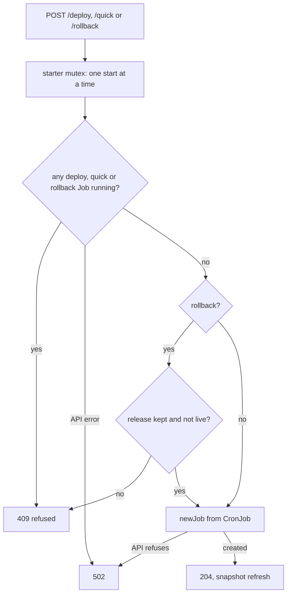

# Starting a deploy, quick deploy or rollback

The only write to the cluster. The page arms a button on the first click and starts on a second
click within 4 s.

Why guard here when `switchyard.sh` refuses too: it only refuses after its Job started, which
leaves a failed Job behind and makes the page show a red run for nothing.

## The Job

`newJob` does what `kubectl create job --from=cronjob/<name>` does:

- GET the CronJob (`SWITCHYARD_JOB_PREFIX` + the kind), take its `jobTemplate` **unchanged** (labels, annotations, spec as raw JSON)
- add annotation `cronjob.kubernetes.io/instantiate: manual`
- name `<cronjob>-<unix seconds>`, for a rollback `rollback-r<n>-<unix seconds>`: the release to
  go back to travels in the name, the only part of the Job the admission policy leaves free;
  likewise `deploy-drops-<unix seconds>` (or `quick-`) for Deploy anyway, which lets destructive
  migrations through
- one ownerReference to the CronJob, `controller: true`

The CronJobs are suspended; they exist only as templates. Anything that changes the Job's shape
must also change the admission policy (see [cluster-access.md](cluster-access.md)).

## `switchyard check`

Runs `newJob` for all three CronJobs with `?dryRun=All`: the API server runs RBAC and the admission
policy but keeps nothing. Use after applying the manifests again.
